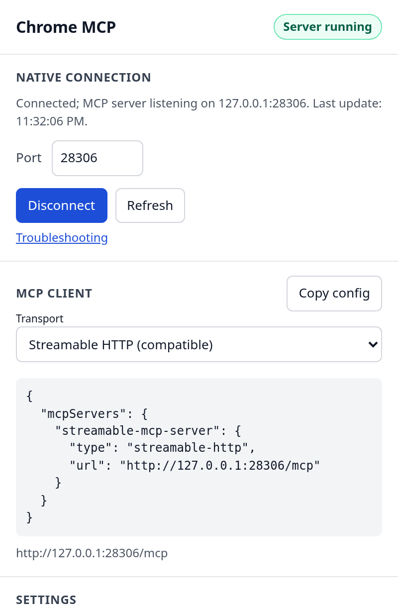
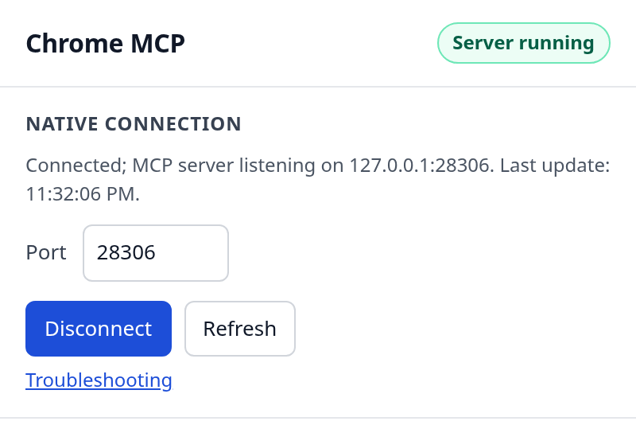
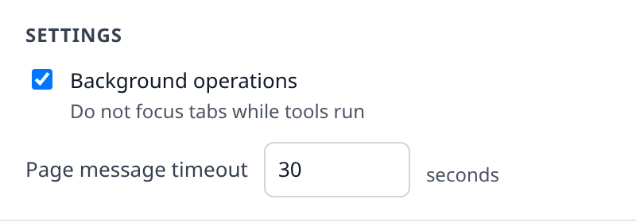
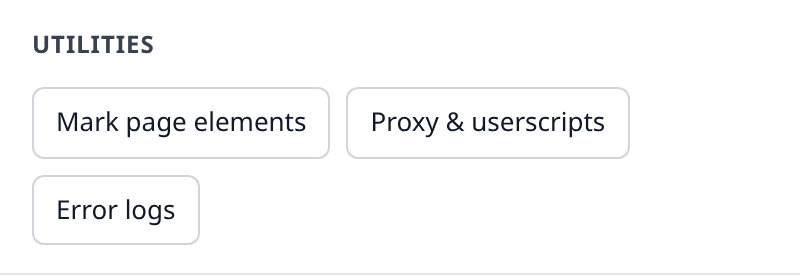
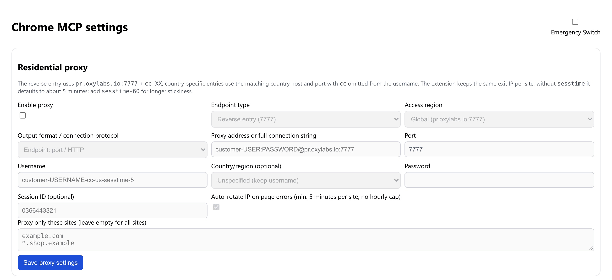
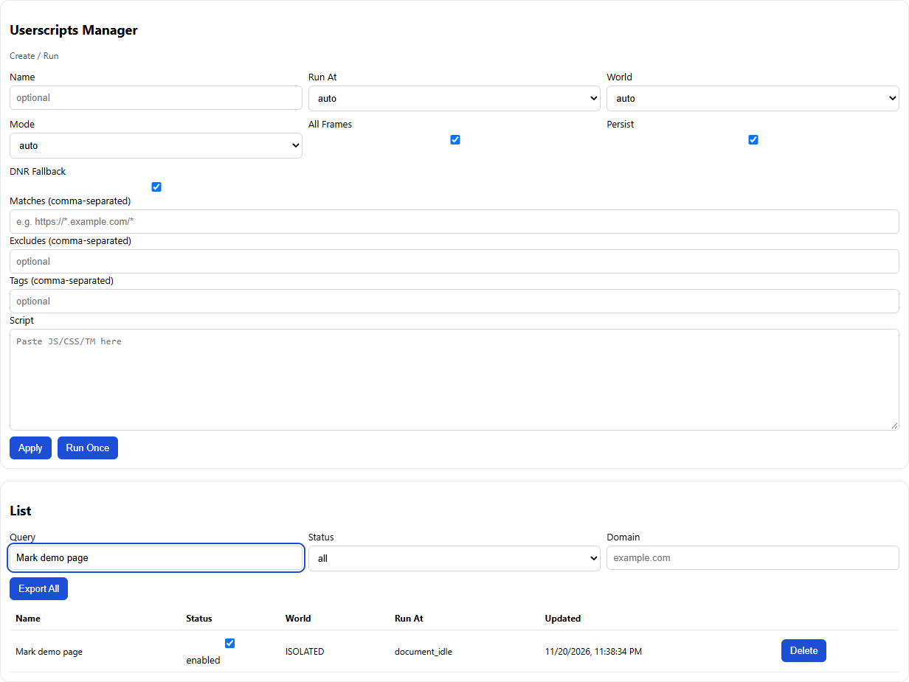

<p align="center">
  
</p>

<h1 align="center">Agent Chrome MCP</h1>

<p align="center">
  Control an existing Chrome session from a Model Context Protocol client
  through a local Chrome extension and native bridge.
</p>

---

## What this project is

The extension (`app/chrome-extension/`) uses Chrome APIs to interact with pages,
capture screenshots, inspect network traffic, and manage browser data such as
cookies, bookmarks, history, and downloads.

The bridge (`app/native-server/`) connects to the extension through Chrome
Native Messaging and serves MCP over Streamable HTTP, legacy SSE, and STDIO.
Both components use the tool schemas and native protocol in `packages/shared/`.

Your MCP client runs the model and decides when to call the browser tools.

## Requirements

- Chrome or Chromium
- Node.js 24 or newer for the bridge
- pnpm 12 for building from source

## Install

Download the extension and bridge from the [latest release](https://github.com/spgsroot/agent-chrome-mcp/releases/latest).

- `agent-chrome-mcp-extension-2.8.6.zip`
- `agent-chrome-mcp-bridge-2.8.6.tar.gz`

Use the filenames from your release in the commands below. The bridge archive
includes its production dependencies and runs with Node.js 24 or newer.

### 1. Load the extension

Unzip the extension, open `chrome://extensions/`, enable **Developer mode**, click
**Load unpacked**, and select the unzipped directory. Copy its extension ID.


### 2. Register the native bridge

On macOS or Linux, run these commands from the directory containing the archive.

```bash
tar -xzf agent-chrome-mcp-bridge-2.8.6.tar.gz
cd agent-chrome-mcp-bridge
node dist/cli.js --version
CHROME_MCP_EXTENSION_ID=YOUR_EXTENSION_ID node dist/cli.js register --browser chrome
```

In Windows PowerShell, start in the directory containing the archive.

```powershell
tar -xzf agent-chrome-mcp-bridge-2.8.6.tar.gz
Set-Location agent-chrome-mcp-bridge
node dist/cli.js --version
$env:CHROME_MCP_EXTENSION_ID = 'YOUR_EXTENSION_ID'
node dist/cli.js register --browser chrome
```

Replace `YOUR_EXTENSION_ID` with the ID from `chrome://extensions/`. Select
`--browser chromium` for Chromium. The registration stores the bridge's
absolute path. Keep the extracted bridge in the same location.

Click **Connect** in the extension popup. Chrome starts the native bridge, and
the popup shows **Server running** once MCP is ready. To change the port,
disconnect, enter a free port, and connect again. The bridge uses
`CHROME_MCP_PORT` first, then `MCP_HTTP_PORT`, then the saved popup port.
The default is `12306`.



The bridge registers as `com.chromemcp.nativehost` for protocol compatibility.
It replaces any existing registration under that name, including an older
mcp-chrome installation.

### 3. Configure your MCP client

For STDIO, replace the example path with the absolute path to the bridge.
STDIO works without an HTTP API key.

```json
{
  "mcpServers": {
    "agent-chrome-mcp": {
      "command": "node",
      "args": ["/absolute/path/agent-chrome-mcp-bridge/dist/cli.js", "--stdio"]
    }
  }
}
```

If you changed the port in the extension, set `MCP_SERVER_URL` in the STDIO
client's environment to `http://127.0.0.1:PORT/mcp-new`, using the port shown in
the popup.

For HTTP, choose `http://127.0.0.1:12306/mcp-new` for stateless requests,
`http://127.0.0.1:12306/mcp` for sessions, or `/sse` for a legacy client.
Set `CHROME_MCP_API_KEY` in the bridge's environment and send the same key
as `Authorization: Bearer ...`. The bridge requires a key or an allowed Origin.
See [Security](#security).

### Build from source

```bash
git clone https://github.com/spgsroot/agent-chrome-mcp.git
cd agent-chrome-mcp
pnpm install --frozen-lockfile
pnpm build
```

Load `app/chrome-extension/.output/chrome-mv3`, then register
`app/native-server/dist/cli.js` with `CHROME_MCP_EXTENSION_ID` as above.

## Try it on a local demo page

Serve the [seedling inventory demo](docs/demo/index.html) from the repository root
with Python 3.

```bash
python -m http.server 8765 --bind 127.0.0.1 --directory docs/demo
```

Connect the extension, then call the following tools from your MCP client.
This example ran on Windows in a fresh Chromium profile against the compatible
Streamable HTTP endpoint (`/mcp`).

1. Call `chrome_navigate` with these arguments. Keep the `tabId` from the first
   entry in the response's `tabs` array.

   ```json
   {
     "url": "http://127.0.0.1:8765/",
     "newWindow": true,
     "width": 1100,
     "height": 760,
     "waitForReady": true,
     "background": false
   }
   ```

2. Call `chrome_screenshot` with these arguments, replacing `123` with the
   returned `tabId`. For this capture mode, the response includes the JPEG in
   the `base64Data` field of the tool's JSON payload.

   ```json
   { "tabId": 123, "fullPage": false, "storeBase64": true, "background": true }
   ```


With the extension connected on the default port, run `pnpm test:chrome-smoke`
to verify the native host, tool discovery, and a `chrome_get_tab_url` call.
Set `CHROME_MCP_SMOKE_URL` for a different port and `CHROME_MCP_SMOKE_ORIGIN`
to `chrome-extension://YOUR_EXTENSION_ID` if the bridge pins the extension origin.

### JavaScript userscripts

JavaScript userscripts use Chrome's `userScripts` permission. In Chrome 138
or newer, open `chrome://extensions/`, select **Details** for Chrome MCP Server,
and turn on **Allow User Scripts** before using **Options → Userscripts**.
Chrome 135–137 uses **Developer mode** for this permission. CSS userscripts
and the other browser tools work with **Allow User Scripts** off.

Use **Matches** to choose pages and **Excludes** to skip specific URLs. If both
Matches and the script's matching metadata are empty, the extension uses the
scheme and host of the last web tab in the Options window. JavaScript runs in a
separate userscript world by default. Turn off **Allow User Scripts** to stop
new executions, including after a reload.

See [Chrome's User Scripts documentation](https://developer.chrome.com/docs/extensions/reference/api/userScripts).

## Interface






<details>
<summary>Element picker and error logs</summary>


</details>

<details>
<summary>Proxy and Userscripts settings</summary>




</details>

## Security

The bridge listens on loopback. It checks authorization for `/mcp*`, `/sse`,
`/messages`, `/status`, diagnostics, service control, request cancellation,
and artifact downloads.

Use a valid `CHROME_MCP_API_KEY` as a Bearer token or `x-api-key`, or connect
from an allowed browser `Origin`. The bridge accepts `chrome-extension://`
origins and the bundled STDIO origin `chrome-extension://mcp-stdio`. To let a
web UI connect, add its exact origin to `CHROME_MCP_ALLOWED_ORIGINS`. Use commas
between entries. This also applies to pages at `http://127.0.0.1:*` and
`http://localhost:*`.

The bridge returns `403` for a disallowed Origin, even when a request includes
a key. For a request that has no Origin and lacks valid credentials, the
bridge returns `401` when an API key is configured and `403` otherwise.

Set `CHROME_MCP_EXTENSION_ID` in the bridge process environment to limit
extension origins to that ID and `chrome-extension://mcp-stdio`. The popup
reads connection status through Native Messaging.

The tool result includes a one-time `token` for `/artifacts/:id`. A valid API
key also authorizes artifact downloads.

### Bridge environment variables

| Variable                                                                                 | Purpose                                          |
| ---------------------------------------------------------------------------------------- | ------------------------------------------------ |
| `CHROME_MCP_PORT` / `MCP_HTTP_PORT`                                                      | HTTP port (default `12306`)                      |
| `CHROME_MCP_ALLOWED_ORIGINS`                                                             | Exact extra origins allowed on privileged routes |
| `CHROME_MCP_EXTENSION_ID`                                                                | Exact Chrome extension ID                        |
| `CHROME_MCP_MAX_CONCURRENT_TOOLS`                                                        | Concurrent tool calls (default `8`)              |
| `CHROME_MCP_MAX_QUEUED_TOOLS`                                                            | Admission queue length (default `64`)            |
| `CHROME_MCP_ALLOWED_TOOLS` / `CHROME_MCP_APPROVED_TOOLS` / `CHROME_MCP_REQUIRE_APPROVAL` | Tool scope and approval policy                   |
| `CHROME_MCP_MAX_HTTP_BODY_BYTES`                                                         | HTTP request body cap (default 8 MiB)            |
| `CHROME_MCP_ENABLE_DEBUG_ENDPOINTS`                                                      | Enables `/__chrome_mcp_bridge/start` and `/stop` |

## Browser tools

Use the tools to navigate tabs, read the DOM, page text, and accessibility data, click
controls, and fill forms. They can capture screenshots, PDFs, and GIFs,
inspect console and debugger state, capture and replay network requests, and
manage cookies, storage, bookmarks, history, and downloads. The catalog also
covers isolated Chrome profiles and bounded page collection. See
[docs/TOOLS.md](docs/TOOLS.md).

## Development

```bash
pnpm typecheck
pnpm lint
pnpm --filter @ethanwilkins/mcp-chrome-bridge-2026 test
pnpm --filter @ethanwilkins/chrome-mcp-server-2026 test
pnpm build
pnpm check:tool-docs
```

After building, package the bridge with its locked production dependencies.

```bash
pnpm package:bridge
tar -czf releases/agent-chrome-mcp-bridge-2.8.6.tar.gz -C releases agent-chrome-mcp-bridge
```

On Windows, run `pnpm package:windows` to build a portable executable with the
bridge runtime and the extension.

See the [architecture notes](docs/ARCHITECTURE.md), [troubleshooting guide](docs/TROUBLESHOOTING.md),
and [Native Messaging diagnostics](docs/TROUBLESHOOTING_NATIVE_HOST.md).

## License

The project uses the MIT license. See [LICENSE](LICENSE).
It retains the original license and attribution from
[mcp-chrome-2026](https://github.com/spgsroot/mcp-chrome-2026-en).
