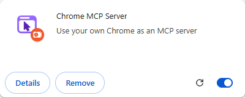
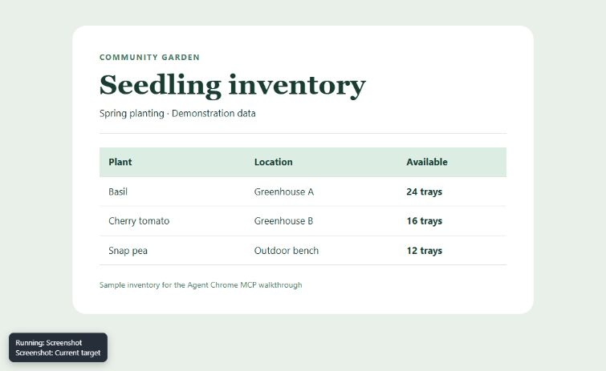
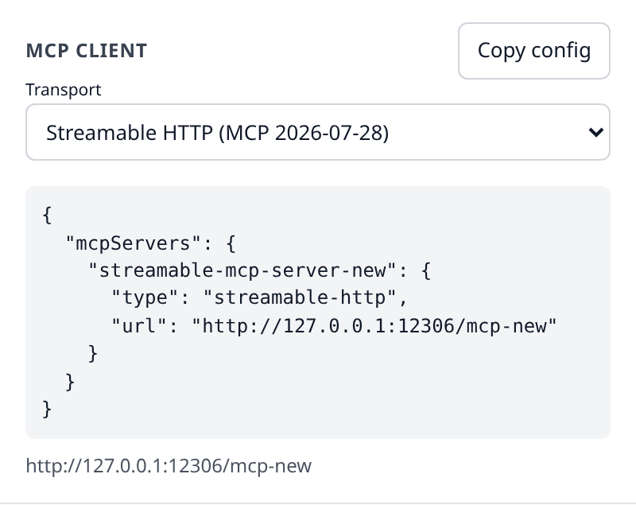
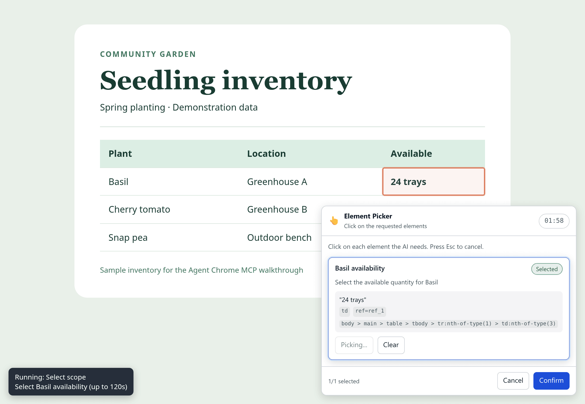
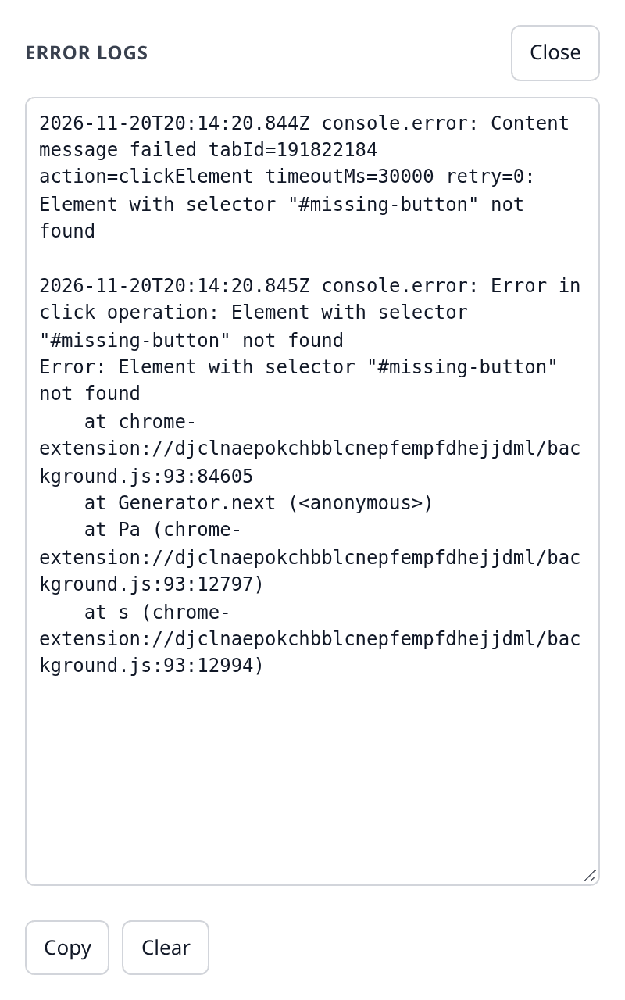

<p align="center">
  
</p>

<h1 align="center">Agent Chrome MCP</h1>

<p align="center">
  <b>Browser-only control for MCP clients</b><br />
  A local Chrome extension and native bridge that expose your existing browser
  session over the Model Context Protocol.
</p>

---

## What this project is

- **Chrome extension** (`app/chrome-extension/`) — owns Chrome APIs, DOM
  interaction, screenshots, network inspection, cookies, storage, bookmarks,
  history, downloads, and the rest of the browser tool surface.
- **Native bridge** (`app/native-server/`) — Chrome Native Messaging host and
  local MCP server exposing Streamable HTTP, legacy SSE, and STDIO transports.
- **Shared package** (`packages/shared/`) — MCP tool schemas and the native
  protocol used by both sides.

Your MCP client runs the model and decides when to call the browser tools.

## Requirements

- Chrome or Chromium
- Node.js 24 or newer for the bridge
- pnpm 12 for building from source

## Install

Download both assets from the [latest release](https://github.com/spgsroot/agent-chrome-mcp/releases/latest):

- `agent-chrome-mcp-extension-2.8.5.zip`
- `agent-chrome-mcp-bridge-2.8.5.tar.gz`

The bridge archive includes its production dependencies. Node.js 24 or newer is
required; no npm package installation is needed. This release was tested on macOS
arm64 with Chrome for Testing. Windows and Linux are not release-tested.

### 1. Load the extension

Unzip the extension, open `chrome://extensions/`, enable **Developer mode**, click
**Load unpacked**, and select the unzipped directory. Copy its extension ID.



### 2. Register the native bridge

Extract the bridge to a permanent directory. Run these commands from the
directory that contains the downloaded archive on macOS or Linux.

```bash
tar -xzf agent-chrome-mcp-bridge-2.8.5.tar.gz
cd agent-chrome-mcp-bridge
node dist/cli.js --version
CHROME_MCP_EXTENSION_ID=YOUR_EXTENSION_ID node dist/cli.js register --browser chrome
```

In Windows PowerShell, use the following commands.

```powershell
tar -xzf agent-chrome-mcp-bridge-2.8.5.tar.gz
Set-Location agent-chrome-mcp-bridge
node dist/cli.js --version
$env:CHROME_MCP_EXTENSION_ID = 'YOUR_EXTENSION_ID'
node dist/cli.js register --browser chrome
```

Replace `YOUR_EXTENSION_ID` with the ID from `chrome://extensions/`. Choose
`--browser chromium` if you loaded the extension in Chromium. Registration
stores the bridge's absolute path, so keep the extracted directory in place.
Open the extension popup and click **Connect**. Chrome starts the native bridge
and the popup shows **Server running** when the MCP endpoint is ready.
To change the listening port, disconnect, enter a free port, and connect again.
The native host uses `CHROME_MCP_PORT` first, then `MCP_HTTP_PORT`, then the
saved popup port. The default is `12306`.


The native-host name remains `com.chromemcp.nativehost` for protocol compatibility.
Registration replaces an existing registration under that name. Do not register
this build alongside an older mcp-chrome installation you still use.

### 3. Configure your MCP client

STDIO requires no HTTP API key. Replace the path below with the bridge's absolute
path.

```json
{
  "mcpServers": {
    "agent-chrome-mcp": {
      "command": "node",
      "args": ["/absolute/path/agent-chrome-mcp-bridge/dist/cli.js", "--stdio"]
    }
  }
}
```

If you changed the port in the extension, set `MCP_SERVER_URL` in the STDIO
client's environment to `http://127.0.0.1:PORT/mcp-new`, using the port shown in
the popup.

For HTTP clients, use `http://127.0.0.1:12306/mcp-new` (stateless),
`http://127.0.0.1:12306/mcp` (session-based), or `/sse` (legacy). Configure
`CHROME_MCP_API_KEY` in the bridge process environment and send the same key as
`Authorization: Bearer ...`. A bare HTTP URL is insufficient: requests without a
key or explicitly allowed Origin are rejected. See [Security](#security).

### Build from source

```bash
git clone https://github.com/spgsroot/agent-chrome-mcp.git
cd agent-chrome-mcp
pnpm install --frozen-lockfile
pnpm build
```

Load `app/chrome-extension/.output/chrome-mv3`, then register
`app/native-server/dist/cli.js` with `CHROME_MCP_EXTENSION_ID` as above.

## Try it on a local demo page

Serve the [seedling inventory demo](docs/demo/index.html) from the repository root
with Python 3.

```bash
python -m http.server 8765 --bind 127.0.0.1 --directory docs/demo
```

Connect the extension and use your MCP client's tool panel to make these calls.
The example was verified against the compatible Streamable HTTP endpoint
(`/mcp`) with a source build on Windows and a fresh Chromium profile.

1. Call `chrome_navigate` with these arguments. Keep the `tabId` from the first
   entry in the response's `tabs` array.

   ```json
   {
     "url": "http://127.0.0.1:8765/",
     "newWindow": true,
     "width": 1100,
     "height": 760,
     "waitForReady": true,
     "background": false
   }
   ```

2. Call `chrome_screenshot` with these arguments, replacing `123` with the
   returned `tabId`. For this capture mode, the response includes the JPEG in
   the `base64Data` field of the tool's JSON payload.

   ```json
   { "tabId": 123, "fullPage": false, "storeBase64": true, "background": true }
   ```



With the extension connected on the default port, run `pnpm test:chrome-smoke`
to verify the native host, tool discovery, and a `chrome_get_tab_url` call.
Set `CHROME_MCP_SMOKE_URL` for a different port and `CHROME_MCP_SMOKE_ORIGIN`
to `chrome-extension://YOUR_EXTENSION_ID` if the bridge pins the extension origin.

### JavaScript userscripts

JavaScript userscripts use Chrome's `userScripts` permission. In Chrome 138
or newer, open `chrome://extensions/`, select **Details** for Chrome MCP Server,
and turn on **Allow User Scripts** before using **Options → Userscripts**.
Chrome 135–137 uses **Developer mode** for this permission. CSS userscripts
and the other browser tools work with **Allow User Scripts** off.

Enter page patterns under **Matches** and exceptions under **Excludes**. When
Matches is empty and the script has no matching metadata, the extension uses
the last web tab in the Options window to derive the scheme and host. JavaScript
runs in a separate userscript world by default. Turning off **Allow User Scripts**
prevents new executions, including after reload.

See [Chrome's User Scripts documentation](https://developer.chrome.com/docs/extensions/reference/api/userScripts).

## Interface

The popup shows the native connection, the selected MCP client configuration,
browser tool settings, and shortcuts to page tools and diagnostics.





<details>
<summary>Element picker and error logs</summary>




</details>

<details>
<summary>Proxy and Userscripts settings</summary>


</details>

## Security

The service is loopback-only. Every privileged route (`/mcp*`, `/sse`,
`/messages`, `/status`, diagnostics, service control, request cancellation, and
artifacts) uses one authorization boundary:

- a valid `CHROME_MCP_API_KEY` (Bearer token or `x-api-key`), or
- an allowed browser `Origin`:
  - a `chrome-extension://` origin (the extension popup / MCP bridge), or
  - the bundled STDIO origin `chrome-extension://mcp-stdio`, or
  - an origin listed in `CHROME_MCP_ALLOWED_ORIGINS` (comma-separated, exact
    match).

Requests with neither an allowed Origin nor a key are rejected with `403`.
Local web pages (`http://127.0.0.1:*` and `http://localhost:*`) are **not**
trusted implicitly; add one to `CHROME_MCP_ALLOWED_ORIGINS` only when a local
web UI must connect.

Set `CHROME_MCP_EXTENSION_ID` in the bridge process environment to pin the
accepted extension Origin. Without it, any installed Chrome extension origin is
accepted; with it, only that ID and `chrome-extension://mcp-stdio` are accepted.
The popup reads status through native messaging rather than privileged HTTP.

Artifacts are capability URLs: `/artifacts/:id` requires the one-time `token`
returned with the tool result.

Other environment variables:

| Variable                                                                                 | Purpose                                          |
| ---------------------------------------------------------------------------------------- | ------------------------------------------------ |
| `CHROME_MCP_PORT` / `MCP_HTTP_PORT`                                                      | HTTP port (default `12306`)                      |
| `CHROME_MCP_ALLOWED_ORIGINS`                                                             | Exact extra origins allowed on privileged routes |
| `CHROME_MCP_EXTENSION_ID`                                                                | Exact Chrome extension ID                        |
| `CHROME_MCP_MAX_CONCURRENT_TOOLS`                                                        | Concurrent tool calls (default `8`)              |
| `CHROME_MCP_MAX_QUEUED_TOOLS`                                                            | Admission queue length (default `64`)            |
| `CHROME_MCP_ALLOWED_TOOLS` / `CHROME_MCP_APPROVED_TOOLS` / `CHROME_MCP_REQUIRE_APPROVAL` | Tool scope and approval policy                   |
| `CHROME_MCP_MAX_HTTP_BODY_BYTES`                                                         | HTTP request body cap (default 8 MiB)            |
| `CHROME_MCP_ENABLE_DEBUG_ENDPOINTS`                                                      | Enables `/__chrome_mcp_bridge/start` and `/stop` |

## Browser tools

The retained MCP surface covers tabs and navigation, DOM/text/accessibility
extraction, clicking and form input, screenshots and PDF, GIF capture, network
capture and request replay, console and debugger state, cookies, storage,
bookmarks, history, downloads, isolated Chrome profiles, and bounded page
collection. See [docs/TOOLS.md](docs/TOOLS.md) for the full catalog.

## Development

```bash
pnpm typecheck
pnpm lint
pnpm --filter @ethanwilkins/mcp-chrome-bridge-2026 test
pnpm --filter @ethanwilkins/chrome-mcp-server-2026 test
pnpm build
pnpm check:tool-docs
```

To produce a bridge directory with locked production dependencies after building:

```bash
pnpm package:bridge
tar -czf releases/agent-chrome-mcp-bridge-2.8.5.tar.gz -C releases agent-chrome-mcp-bridge
```

The Windows portable bridge executable is built on Windows with
`pnpm package:windows`; it bundles the bridge runtime and the extension build.

Architecture details: [docs/ARCHITECTURE.md](docs/ARCHITECTURE.md).
Troubleshooting: [docs/TROUBLESHOOTING.md](docs/TROUBLESHOOTING.md) and
[docs/TROUBLESHOOTING_NATIVE_HOST.md](docs/TROUBLESHOOTING_NATIVE_HOST.md).

## License

MIT — see [LICENSE](LICENSE). This project is derived from
[mcp-chrome-2026](https://github.com/spgsroot/mcp-chrome-2026-en); the original
MIT license and attribution are preserved.
