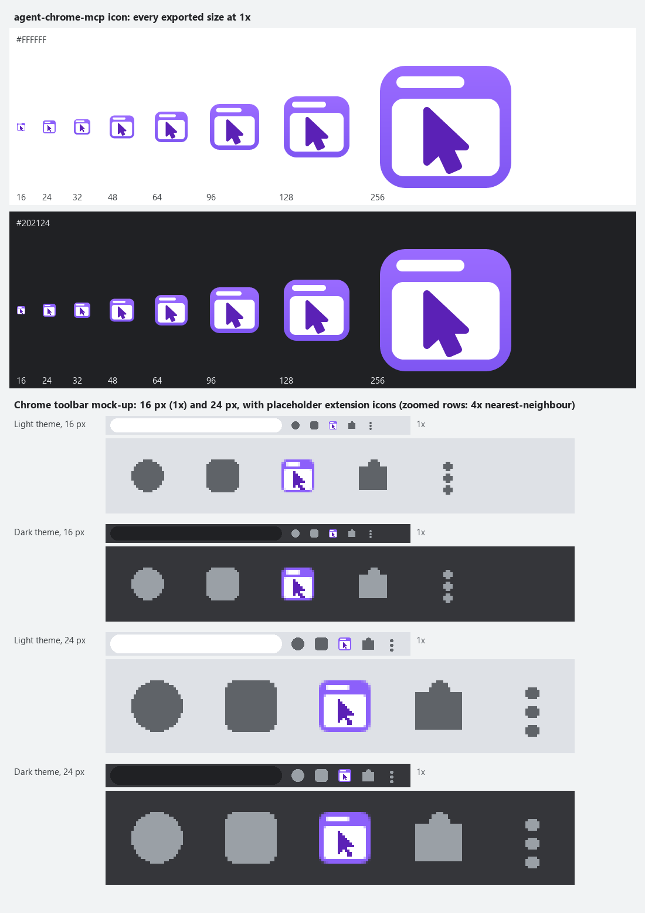

# agent-chrome-mcp icon

A browser window driven by an agent: a violet window with an address bar,
a white page and a large deep-violet cursor arrow on the page. There is no
text and no Chrome or Google branding.



## Files

| File | Size | Format | Rendered from |
| --- | --- | --- | --- |
| `source/icon.svg` | 128 grid, scalable | SVG | master artwork, used for 48 px and up |
| `source/icon-32.svg` | 32 × 32 | SVG | pixel-hinted variant for 32 px |
| `source/icon-24.svg` | 24 × 24 | SVG | pixel-hinted variant for 24 px (ICO only) |
| `source/icon-16.svg` | 16 × 16 | SVG | pixel-hinted variant for 16 px |
| `png/16.png` | 16 × 16 | PNG, RGBA | `source/icon-16.svg` |
| `png/32.png` | 32 × 32 | PNG, RGBA | `source/icon-32.svg` |
| `png/48.png` | 48 × 48 | PNG, RGBA | `source/icon.svg` |
| `png/96.png` | 96 × 96 | PNG, RGBA | `source/icon.svg` |
| `png/128.png` | 128 × 128 | PNG, RGBA | `source/icon.svg` |
| `chrome-mcp.ico` | 16, 24, 32, 48, 64, 256 | ICO, PNG-compressed frames | 16/24/32 from the hinted SVGs, 48/64/256 from `source/icon.svg` |
| `preview.png` | 1100 × 1554 | PNG | every size on #FFFFFF and #202124, plus a toolbar mock-up at 16 and 24 px |

## Integration

The file names already match the paths the project uses, so integration is a
plain copy that overwrites the old files:

| New file | Copy to (existing path) | Used by |
| --- | --- | --- |
| `assets/icon/png/16.png` | `app/chrome-extension/public/icon/16.png` | extension `icons` and the toolbar action at 1x (WXT auto-discovers `public/icon/<size>.png`) |
| `assets/icon/png/32.png` | `app/chrome-extension/public/icon/32.png` | extension icon and the toolbar action at 2x |
| `assets/icon/png/48.png` | `app/chrome-extension/public/icon/48.png` | `chrome://extensions` page |
| `assets/icon/png/96.png` | `app/chrome-extension/public/icon/96.png` | high-DPI extension pages |
| `assets/icon/png/128.png` | `app/chrome-extension/public/icon/128.png` | install dialog, Chrome Web Store, and the `README.md` header image |
| `assets/icon/chrome-mcp.ico` | `assets/chrome-mcp.ico` | Windows launcher icon (`scripts/package-windows.mjs` → `scripts/set-windows-icon.ps1`) |

```sh
cp assets/icon/png/{16,32,48,96,128}.png app/chrome-extension/public/icon/
cp assets/icon/chrome-mcp.ico assets/chrome-mcp.ico
```

No code changes are needed:

- `wxt.config.ts` does not list icons. WXT reads them from
  `public/icon/<size>.png`, and the `action` falls back to the same icons
  because it sets no `default_icon`.
- `README.md` already points at `app/chrome-extension/public/icon/128.png`.
- `set-windows-icon.ps1` already copies every frame of a multi-size ICO into the EXE.

## Colours and contrast

| Role | Colour | vs #FFFFFF | vs #202124 |
| --- | --- | --- | --- |
| Window, gradient top | `#9A6BFF` | 3.55 | 4.54 |
| Window, flat (16/24 px) | `#8C60FA` | 4.06 | 3.96 |
| Window, gradient bottom | `#7F56F2` | 4.65 | 3.46 |
| Cursor on white page | `#5B21B6` | 8.98 | n/a |

Every window colour clears the 3:1 non-text contrast threshold on both a light
and a dark toolbar.

## Re-rendering

The PNGs were rendered with `@resvg/resvg-js` 2.6.2:

```js
const { Resvg } = require('@resvg/resvg-js');
const png = new Resvg(svg, { fitTo: { mode: 'width', value: size } }).render().asPng();
```

Render each size from the SVG listed in the table above. The hinted variants
must be rendered at their native size only. The ICO stores the six PNG frames
as is, in the standard ICONDIR layout.
