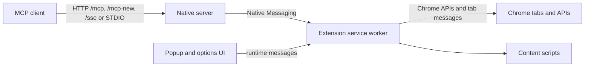
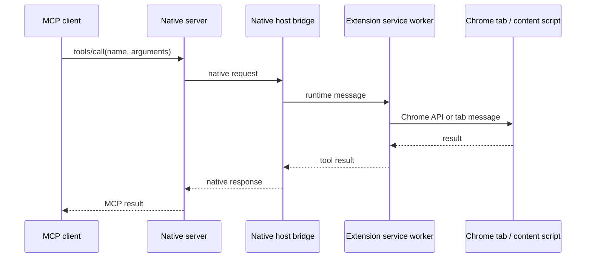

# Architecture

Chrome MCP Bridge connects an MCP client to the user's existing Chrome profile
through a local service and a Manifest V3 extension. The extension owns browser
access; the local Node.js process exposes the MCP transports and forwards
browser tool calls over Chrome Native Messaging.

## Runtime components

### Native server (`app/native-server/`)

- `src/server/index.ts` creates the Fastify server, owns the single
  authorization boundary, and exposes health, status, diagnostics, artifact, and
  MCP routes.
- `src/mcp/` owns protocol transports, tool registration, permission filtering,
  and request admission/backpressure.
- `src/native-messaging-host.ts` connects the local process to the extension
  using Chrome Native Messaging, including artifact transfer and cancellation.
- `src/browser-profile-manager.ts` starts isolated Chrome profiles; profile data
  stays in the legacy `~/.chrome-mcp-agent/browser-profiles` directory so
  existing profiles keep working.

### Chrome extension (`app/chrome-extension/`)

- `entrypoints/background/` is the Manifest V3 service worker. It registers
  runtime listeners and routes tools to browser APIs, content scripts, and
  page-side helpers.
- `entrypoints/`, `inject-scripts/`, and `shared/` implement page interaction
  and reusable UI behavior.
- `entrypoints/popup/` and `options/` provide browser status and settings.

### Shared contracts (`packages/shared/`)

`src/tools.ts` defines the canonical browser tool schemas; `src/tools-zh.ts`
keeps the Chinese descriptions used by the extension localization. The native
server and extension consume the same names and input shapes. `native-protocol.ts`
defines the versioned native request/response/event contract.

## Browser tool request flow

The `/mcp` endpoint maintains client sessions; `/mcp-new` is stateless; `/sse`
preserves the legacy transport. STDIO clients use the bridge executable, which
runs the same native server and protocol implementation.

## Authorization and limits

All privileged routes share one on-request authorization boundary. A caller is
trusted by an API key, an allowed extension origin, the bundled STDIO origin, or
an explicitly configured origin. Local web pages are not trusted implicitly.
Artifacts are capability URLs with one-time tokens. Tool admission caps
concurrency, queue length, per-call deadlines, and request body size; see the
root README for the environment variables.

## Build and verification

- `pnpm build` builds the shared package, native server, and extension.
- `.github/workflows/ci.yml` runs type checking, lint, unit/integration tests,
  builds, and a native-server admission gate. The real Chrome smoke test is a
  manually dispatched acceptance job on a prepared Windows runner.

## Source map

| Concern                               | Source                                               |
| ------------------------------------- | ---------------------------------------------------- |
| MCP HTTP/SSE routes and status        | `app/native-server/src/server/`                      |
| MCP tool registration and permissions | `app/native-server/src/mcp/`                         |
| Native messaging bridge               | `app/native-server/src/native-messaging-host.ts`     |
| Extension tool implementations        | `app/chrome-extension/entrypoints/background/tools/` |
| Page injection helpers                | `app/chrome-extension/inject-scripts/`               |
| Shared tool schemas                   | `packages/shared/src/tools.ts`                       |
| Native protocol contract              | `packages/shared/src/native-protocol.ts`             |
